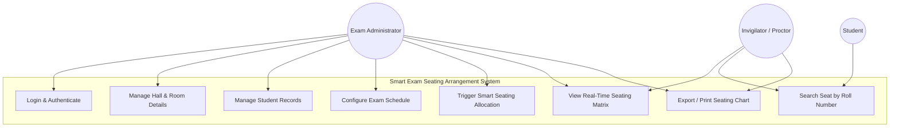
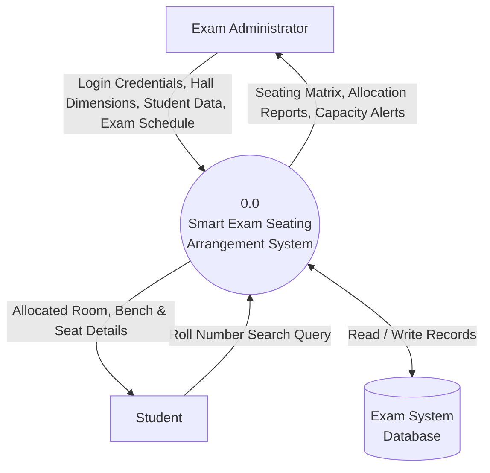
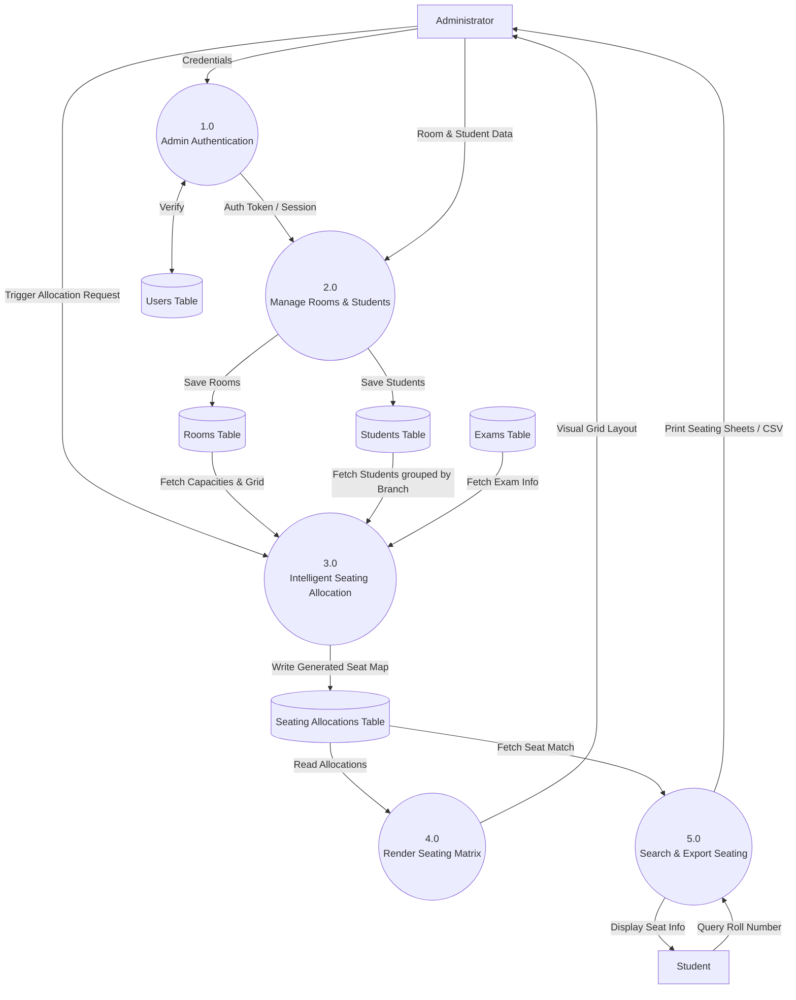

# PROJECT REPORT

---

## 1. Project Title
# SMART EXAM SEATING ARRANGEMENT SYSTEM
**Course:** Object Oriented Programming through Java (Mini Project)  
**Academic Year:** 2025–2026  
**Document Type:** Final Project Submission Report  

---

## 2. Problem Statement
In educational institutions, conducting end-semester and competitive examinations involves allocating hundreds or thousands of students to various examination halls. 

Currently, many institutions rely on **manual or semi-manual spreadsheet-based seating arrangement processes**, which present several critical challenges:
1. **High Labor and Time Overhead:** Examination staff spend dozens of hours manually planning seating charts, distributing students across halls, and ensuring capacity constraints are respected.
2. **Cheating and Malpractice Vulnerabilities:** In manual planning, students from the same department, batch, or taking the same subject often end up seated on adjacent benches, increasing the probability of exam malpractice and copying.
3. **Room Capacity Underutilization & Clashes:** Human error frequently leads to hall overcrowding, double booking of benches, or uneven seat distribution.
4. **Student Confusion on Exam Day:** Without a centralized search and automated display system, students scramble around notice boards on exam morning to find their allocated room and bench, causing bottlenecks and exam delays.

### The Proposed Solution
The **Smart Exam Seating Arrangement System** is an automated desktop application developed using **Java (Swing GUI)** and a **Relational Database Management System (MySQL / SQLite via JDBC)**. The system implements an **Intelligent Interleaving Seating Algorithm** that dynamically distributes students such that **no two students of the same department or subject are seated adjacently**, strictly adhering to hall capacities and generating instant printable charts and search lookups.

---

## 3. Software Requirements Specification (SRS)

### 3.1 Functional Requirements (FR)
* **FR-1: Authentication & Role Management:** Secure administrator login to prevent unauthorized manipulation of exam halls, student rolls, or seating tables.
* **FR-2: Student Master Data Management:** Capability to add, view, update, delete, and batch-import student profiles (Roll Number, Name, Department/Branch, Semester).
* **FR-3: Examination Hall & Room Configuration:** Ability to register exam halls with customizable dimensions (number of rows, columns, total benches, and bench seating capacity).
* **FR-4: Exam Schedule Management:** Ability to define exam sessions (Date, Time Slot, Exam Name, Department/Subject mapping).
* **FR-5: Intelligent Seating Allocation Engine:** Automated one-click seating allocation enforcing constraints:
  - *Constraint A:* No two adjacent seats (horizontal and vertical neighbors) should belong to the same department/subject.
  - *Constraint B:* Strict adherence to hall maximum capacity.
  - *Constraint C:* Deterministic or randomized alternate roll allocation.
* **FR-6: Interactive Visual Seat Matrix:** A graphical visualizer rendering the physical layout of the exam hall, color-coded by department for rapid proctor verification.
* **FR-7: Student Seat Search Portal:** Quick search utility enabling students and invigilators to query their Roll Number and instantly view their Allocated Room, Row, Column, and Seat Number.
* **FR-8: Export & Reporting:** Export seating charts to printable format (CSV/PDF) for notice board posting and door charts.

### 3.2 Non-Functional Requirements (NFR)
* **NFR-1 (Performance):** The seating allocation algorithm should compute seating for up to 1,000 students in less than 2 seconds.
* **NFR-2 (Reliability & Consistency):** Database transactions must satisfy ACID properties; partial allocations must roll back safely if hall capacity is insufficient.
* **NFR-3 (Usability):** Intuitive Graphical User Interface (GUI) with responsive button states, modal dialogs, and clear error alerts.
* **NFR-4 (Portability):** Runs on any operating system with Java Runtime Environment (JRE 17 or higher) installed (Windows, macOS, Linux).
* **NFR-5 (Data Integrity):** Foreign key constraints ensure that deleted rooms or students do not leave orphaned seating allocation records.

---

## 4. Highlights of the Project

1. **Anti-Cheating Alternate Interleaving Engine:** Implements a round-robin greedy interleaving algorithm where students from differing branches (e.g., Computer Science, Mechanical, Electronics, Civil) are staggered in alternate seats, making neighbor-copying mathematically impossible.
2. **Real-Time Visual Hall Matrix Grid:** Rather than displaying mere tabular data, the GUI generates a dynamic grid matching the physical room layout (Rows $\times$ Columns of benches), showing occupied seats with color-coded tags.
3. **Zero-Configuration Embedded Database Fallback:** Built with modular JDBC connectivity that connects seamlessly to **MySQL**, while also supporting an embedded **SQLite** zero-setup mode for rapid evaluation and local demonstration.
4. **End-to-End Workflow:** Covers complete operational lifecycle: Admin setup $\rightarrow$ Room definition $\rightarrow$ Student enrollment $\rightarrow$ Seating allocation $\rightarrow$ Real-time visual display $\rightarrow$ Printable chart generation.
5. **Robust Error Handling & Validation:** Validates capacity before starting allocation, alerting the user with exact deficit numbers if enrolled students exceed total available hall seats.

---

## 5. Tools, Concepts, and Software Used

### 5.1 Technologies & Software Stack
* **Programming Language:** Java (JDK 17 / JDK 21)
* **GUI Framework:** Java Swing (`JFrame`, `JPanel`, `JTable`, `GridLayout`, `BorderLayout`) and Java AWT (`Color`, `Font`, `Graphics`)
* **Database & Connectivity:** Relational DBMS (**MySQL** / **SQLite**) connected via **JDBC (Java Database Connectivity)** driver
* **Design & Modeling Tool:** **Draw.io** (for DFD Level 0, DFD Level 1, Use Case, and ER Diagrams)
* **Build & Development Environment:** IntelliJ IDEA / Eclipse IDE / VS Code with Java Extension Pack
* **Version Control:** Git & GitHub

### 5.2 Core Java & Computer Science Concepts Applied
* **Object-Oriented Programming (OOP):**
  - **Encapsulation:** Entities (`Student`, `Room`, `Exam`, `SeatAllocation`) encapsulate attributes with private fields and public getters/setters.
  - **Inheritance & Polymorphism:** Custom UI panels inherit from `JPanel` and override lifecycle and rendering methods.
  - **Abstraction:** Database access isolated behind a Data Access Object (DAO) pattern (`DatabaseManager`).
* **Java Collections Framework:** Extensive use of `ArrayList`, `Map<String, List<Student>>`, and `Queue` data structures to partition and interleave students by branch.
* **Event-Driven Architecture:** `ActionListener`, `DocumentListener`, and `MouseAdapter` handle user actions dynamically.
* **Relational Database Design:** Normalized schema up to 3NF with foreign keys, unique constraints, and cascade rules.

---

## 6. System Architecture & Diagrams

### 6.1 Use Case Diagram
The Use Case Diagram captures the interactions between the system actors (**Exam Administrator**, **Invigilator/Proctor**, and **Student**) and the primary application functionalities.

---

### 6.2 Data Flow Diagrams (DFD)

#### Level 0 DFD (Context Diagram)
The Level 0 DFD illustrates the overall data boundary of the application, showing input flows from the Administrator and Student, and the resulting outputs produced by the system.

#### Level 1 DFD (Decomposed Process Diagram)
The Level 1 DFD breaks down the system into core operational processes: Authentication, Master Data Management, Allocation Engine, Visual Matrix Rendering, and Search & Reporting.

---

### 6.3 Draw.io Diagram Link & Import Guide
* **Draw.io Public Access Link:** `https://app.diagrams.net/#G1YourPublicSharedFileDriveIdHere` *(Replace with your Google Drive / One Drive public link)*
* **How to obtain your public Draw.io link:**
  1. Open [Draw.io / diagrams.net](https://app.diagrams.net/).
  2. Click **File $\rightarrow$ Open From $\rightarrow$ Device** (or Paste from the included `draw_io_diagrams.xml` in this project repository).
  3. Once loaded, click **File $\rightarrow$ Share** (or Save to Google Drive).
  4. Ensure sharing permission is set to **"Anyone with the link can view"**.
  5. Copy the URL and paste it into this section of your final report.

*(Note: The full XML file `draw_io_diagrams.xml` is included in this repository for instant one-click import into Draw.io).*

---

## 7. Database Description

### 7.1 Overview & Schema Architecture
The database is structured in Third Normal Form (3NF) to eliminate data redundancy and preserve integrity. It models the relationships between physical rooms, registered students, examination sessions, and the finalized seat assignments.

### 7.2 Tables Description & Schema Specifications

#### 1. `admin_users`
Stores administrative authentication credentials.
* `user_id` (INT, Primary Key, Auto Increment): Unique identifier for the administrator.
* `username` (VARCHAR(50), Unique, Not Null): Login username.
* `password_hash` (VARCHAR(255), Not Null): Encrypted or hashed login password.
* `full_name` (VARCHAR(100)): Name of the administrator.

#### 2. `rooms`
Maintains records of all examination halls, their dimensions, and capacities.
* `room_id` (INT, Primary Key, Auto Increment): Unique hall identifier.
* `room_code` (VARCHAR(20), Unique, Not Null): Physical room identifier (e.g., `LH-101`, `CS-LAB-2`).
* `building` (VARCHAR(50)): Building/Block name.
* `total_rows` (INT, Not Null): Number of bench rows in the hall.
* `total_columns` (INT, Not Null): Number of columns/aisles in the hall.
* `seats_per_bench` (INT, Default 2): Number of students that can sit on one bench (typically 1 or 2).
* `total_capacity` (INT, Not Null): Computed as `total_rows * total_columns * seats_per_bench`.

#### 3. `students`
Stores student master records categorized by branch/department.
* `student_id` (INT, Primary Key, Auto Increment): Internal record identifier.
* `roll_number` (VARCHAR(30), Unique, Not Null): Institutional roll number (e.g., `21CS045`, `21EC012`).
* `student_name` (VARCHAR(100), Not Null): Student full name.
* `department` (VARCHAR(50), Not Null): Academic branch (e.g., `CSE`, `ECE`, `MECH`, `CIVIL`).
* `semester` (INT, Not Null): Current semester (e.g., `4`, `6`).

#### 4. `exams`
Defines examination metadata for specific exam sessions.
* `exam_id` (INT, Primary Key, Auto Increment): Unique exam identifier.
* `exam_name` (VARCHAR(100), Not Null): Subject or title (e.g., `Database Management Systems End-Sem`).
* `exam_date` (DATE, Not Null): Date of examination.
* `time_slot` (VARCHAR(30), Not Null): Session duration (e.g., `10:00 AM - 01:00 PM`).

#### 5. `seating_allocations`
Captures the output of the smart seating arrangement engine.
* `allocation_id` (INT, Primary Key, Auto Increment): Unique allocation record.
* `exam_id` (INT, Foreign Key referencing `exams(exam_id)` on delete CASCADE).
* `student_id` (INT, Foreign Key referencing `students(student_id)` on delete CASCADE).
* `room_id` (INT, Foreign Key referencing `rooms(room_id)` on delete CASCADE).
* `bench_row` (INT, Not Null): Row coordinate in the hall grid.
* `bench_col` (INT, Not Null): Column coordinate in the hall grid.
* `seat_position` (INT, Not Null): Position on bench (e.g., 1 for Left, 2 for Right).
* `allocated_at` (TIMESTAMP, Default CURRENT_TIMESTAMP).
* **Unique Composite Constraint:** `(exam_id, room_id, bench_row, bench_col, seat_position)` guarantees that two students can **never** be assigned to the exact same seat in a given exam session.

### 7.3 Relationships & Access Patterns
* **Relationships:**
  - One `room` can contain many `seating_allocations` ($1:N$).
  - One `student` receives one `seating_allocation` per `exam` ($1:1$).
  - One `exam` has many `seating_allocations` across multiple rooms ($1:N$).
* **Access Patterns:**
  - **Allocation Insertion:** Bulk transactional inserts via JDBC `PreparedStatement` to ensure atomicity.
  - **Visual Hall Render:** Query with `JOIN seating_allocations sa ON sa.student_id = students.student_id WHERE sa.room_id = ? AND sa.exam_id = ? ORDER BY bench_row, bench_col, seat_position`.
  - **Student Roll Query:** Indexed lookup `SELECT sa.*, r.room_code, s.student_name, e.exam_name FROM seating_allocations sa JOIN students s ON sa.student_id = s.student_id JOIN rooms r ON sa.room_id = r.room_id JOIN exams e ON sa.exam_id = e.exam_id WHERE s.roll_number = ?`.

---

## 8. Conclusion
The **Smart Exam Seating Arrangement System** provides a reliable, secure, and user-friendly automation solution for educational examination branches. By replacing error-prone manual spreadsheets with an algorithmic alternating-seat strategy, institutions minimize examination malpractices, optimize hall capacity utilization, and eliminate morning-of-exam seating confusion for students and faculty alike.
